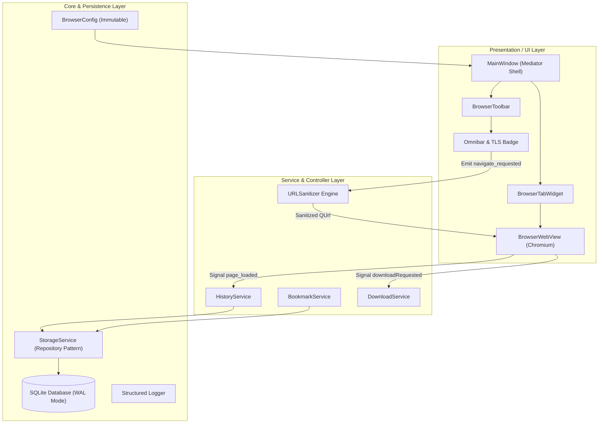

<div align="center">

# 🌐 PyBrowser

**A Production-Grade, Multi-Tab Desktop Web Browser Engineered with Python 3.12+ and Qt 6 (PySide6).**

[](https://github.com)
[](https://python.org)
[](https://www.qt.io/qt-for-python)
[](https://github.com/astral-sh/ruff)
[-blue?style=for-the-badge)](https://mypy-lang.org)
[-green?style=for-the-badge&logo=pytest)](https://pytest.org)
[](LICENSE)

<br/>

```text
 ┌────────────────────────────────────────────────────────────────────────┐
 │ [ < ] [ > ] [ ⟳ ] [ ⌂ ]  🔒 https://duckduckgo.com          [ ★ ] [ ☼ ]│
 ├────────────────────────────────────────────────────────────────────────┤
 │ [ Tab 1: DuckDuckGo  × ] [ Tab 2: Python Docs  × ] [ + ]              │
 ├────────────────────────────────────────────────────────────────────────┤
 │                                                                        │
 │                       Chromium WebEngine View                          │
 │                    Hardware-Accelerated Rendering                      │
 │                                                                        │
 ├────────────────────────────────────────────────────────────────────────┤
 │ Ready                                            [▓▓▓▓▓▓▓▓▓▓ 100%]     │
 └────────────────────────────────────────────────────────────────────────┘
```

</div>

---

## 📌 Executive Summary

**PyBrowser** is a high-performance, modular desktop web browser developed to demonstrate modern software engineering patterns, strict type-safety, and robust asynchronous UI/engine orchestration in Python. Originally a rudimentary PyQt5 single-window script, this project was architecturally refactored into a scalable Clean Architecture application backed by the Chromium-powered Qt 6 WebEngine, SQLite write-ahead logging (WAL) persistence, and comprehensive CI/CD test automation.

---

## ⚡ Key Features & Technical Complexity

- **Multi-Tab Process & Lifecycle Management**:
  - Implements dynamic tab instantiation, detachment, and safe resource deallocation via `QWebEnginePage.deleteLater()` to avoid memory leaks.
  - Intercepts `target="_blank"` and Javascript `window.open` requests through custom `QWebEnginePage.createWindow` hooks to route external links into new foreground tabs seamlessly.
- **Smart Omnibar with Protocol Upgrades**:
  - Distinguishes between RFC-compliant FQDNs, raw IPv4/IPv6 addresses, local developer endpoints (`localhost:3000`), relative file paths, and natural language search queries.
  - Automatically enforces HTTPS upgrades on top-level domain navigation while sanitizing URL parameters against injection.
- **Visual Connection Security Telemetry**:
  - Real-time cryptographic status badge rendering dynamic TLS certificate verification indicators (HTTPS secure vs. unencrypted HTTP warning states).
- **ACID Persistence via Repository Pattern**:
  - Thread-safe SQLite persistence layer utilizing Write-Ahead Logging (`PRAGMA journal_mode = WAL`) for non-blocking concurrent reads.
  - High-performance indexed storage for page browsing histories (with visit frequency counters) and categorized bookmark trees.
- **Native Download Management Pipeline**:
  - Asynchronous background download interception connecting directly to QtWebEngine's request pipeline, featuring collision avoidance, filename sanitization, and live status bar telemetry.
- **Adaptive Ergonomic UI (Dark & Light Modes)**:
  - Custom QSS design system with scalable SVG iconography and responsive state transitions.
- **Full Keyboard Navigation & Accessibility**:
  - Complete shortcut harness: `Ctrl+T` (New Tab), `Ctrl+W` (Close Tab), `Ctrl+L` (Focus Omnibar), `Ctrl+R`/`F5` (Reload), `Ctrl+B` (Bookmarks), `Ctrl+H` (History), `Ctrl++`/`Ctrl+-` (Zoom control).

---

## 🛠️ Modern Tech Stack

| Category | Technology | Purpose |
| :--- | :--- | :--- |
| **Language** | **Python 3.12+ / 3.13** | Strict static typing, `@dataclass(slots=True)`, pattern matching |
| **UI Framework** | **PySide6 (Qt 6.7+)** | Official Qt binding; Chromium-based WebEngine rendering |
| **Storage Engine** | **SQLite3 (WAL Mode)** | Repository-pattern persistence for history and bookmarks |
| **Linting & Formatting** | **Ruff (0.17+)** | Sub-second AST-level linting, isort, and code formatting |
| **Type Analysis** | **Mypy (Strict Mode)** | 100% strict type coverage across core, models, services, and UI |
| **Test Harness** | **Pytest** | Unit testing & headless offscreen Qt GUI integration tests |
| **CI Automation** | **GitHub Actions** | Cross-platform matrix builds (Ubuntu, Windows, macOS) |

---

## 🏛️ System Architecture & Design

PyBrowser adheres to **Clean Architecture** principles and the **Model-View-Presenter (MVP) / Mediator** pattern to decouple the UI from core web protocols and database operations.



### Architectural Decisions & Trade-Offs

1. **PySide6 over PyQt5/PyQt6**:
   - Chosen for official corporate backing from The Qt Company, cleaner LGPLv3 licensing compliance for commercial distributions, and modern Python typing stubs.
2. **Repository Pattern for Storage**:
   - Decoupled database logic from UI controllers through `StorageService`, enabling zero-cost mocking and rapid switching to alternative persistence backends (e.g., PostgreSQL or encrypted SQLCipher).
3. **Headless Offscreen UI Testing**:
   - Configured `QT_QPA_PLATFORM=offscreen` to allow the full tab lifecycle and WebEngine instantiation to be verified within headless Linux/Windows CI build agents without requiring virtual display servers.

---

## 📂 Project Structure

```text
browser/
├── .github/
│   └── workflows/
│       └── ci.yml               # Automated Ruff, Mypy & Pytest multi-platform CI
├── assets/
│   ├── icons/                   # High-DPI scalable SVG icons
│   └── styles/
│       ├── dark.qss             # Modern slate dark theme
│       └── light.qss            # Crisp high-contrast light theme
├── src/
│   └── pybrowser/
│       ├── __init__.py          # Package metadata & version
│       ├── __main__.py          # CLI runnable (python -m pybrowser)
│       ├── app.py               # Application bootstrap & dependency injection
│       ├── core/
│       │   ├── config.py        # Strongly-typed configuration settings
│       │   ├── exceptions.py    # Domain-specific hierarchy
│       │   ├── logger.py        # Centralized structured logging
│       │   └── url_sanitizer.py # Omnibar parser & search resolver
│       ├── models/
│       │   ├── bookmark.py      # Bookmark domain entity
│       │   └── history_item.py  # Browsing history domain entity
│       ├── services/
│       │   ├── bookmark_service.py # Bookmark business logic
│       │   ├── download_service.py # WebEngine download manager
│       │   ├── history_service.py  # History tracking & analytics
│       │   └── storage_service.py  # Thread-safe SQLite repository
│       └── ui/
│           ├── dialogs/         # Modal views (Bookmarks, History)
│           ├── main_window.py   # Application shell mediator
│           ├── omnibar.py       # Address bar with TLS security badge
│           ├── tab_widget.py    # Multi-tab lifecycle container
│           ├── toolbar.py       # Navigation controls & actions
│           └── web_view.py      # Chromium viewport & context hooks
├── tests/
│   ├── conftest.py              # Pytest fixtures & temporary database harnesses
│   ├── test_models.py           # Model serialization & hydration tests
│   ├── test_storage_service.py  # SQLite repository CRUD & index tests
│   ├── test_tab_widget.py       # Headless offscreen tab lifecycle tests
│   └── test_url_sanitizer.py    # URL parsing, localhost, and search tests
├── browser.py                   # Backward-compatible root launcher
├── pyproject.toml               # PEP 621 configuration (Ruff, Mypy, Pytest)
├── .gitignore                   # Comprehensive artifact exclusions
└── README.md                    # Project documentation
```

---

## 🚀 Getting Started

### Prerequisites
- **Python 3.12+** or **Python 3.13**
- `pip` or modern package managers (`uv`, `poetry`)

### 1. Clone the Repository
```bash
git clone https://github.com/your-username/pybrowser.git
cd pybrowser
```

### 2. Set Up Virtual Environment
```bash
# Using standard venv
python -m venv .venv

# On Linux/macOS:
source .venv/bin/activate

# On Windows:
.venv\Scripts\activate
```

### 3. Install Dependencies
```bash
# Install core browser requirements
pip install -e .

# Install development & test tooling
pip install -e ".[dev]"
```

### 4. Run the Application
You can launch PyBrowser using any of the canonical entry points:

```bash
# Modern module invocation
python -m pybrowser

# Or use the installed console script
pybrowser

# Or pass a direct URL / search query on startup
python -m pybrowser "https://github.com"

# Legacy backward-compatible invocation
python browser.py
```

---

## 🧪 Testing & Code Quality

PyBrowser enforces strict enterprise-grade quality gates:

```bash
# 1. Run full unit & headless integration test suite
python -m pytest tests/

# 2. Run Ruff linter
python -m ruff check .

# 3. Verify formatting
python -m ruff format --check .

# 4. Run Mypy static type checker in strict mode
python -m mypy src/
```

---

## 💻 Usage & Key Workflows

### Browsing and Navigation
- Type a web address (e.g. `github.com` or `localhost:8000`) or search terms directly into the Omnibar.
- Press **Enter** to navigate. Notice the Omnibar automatically formats schemes and upgrades to secure HTTPS when available.

### Managing Tabs
- Click the **`+`** button on the tab bar or press `Ctrl+T` to open a new tab.
- Click the close button on any tab or press `Ctrl+W` to close the active tab.

### Bookmarking & History
- Click the **★ (Star)** inside the Omnibar to bookmark the active page with one click.
- Access the Bookmarks Manager with `Ctrl+B` to search, open, or delete bookmarks.
- Access the Browsing History with `Ctrl+H` to review recent activity or purge records.

---

## 🔮 Future Enhancements & Roadmap

- [ ] **Content Ad-Blocker (EasyList / WebEngine URL Interceptor)**: Implement custom `QWebEngineUrlRequestInterceptor` to block advertising trackers and telemetry scripts.
- [ ] **Tab Audio Indicators & Muting**: Detect HTML5 audio playback on tabs and expose interactive speaker mute toggles.
- [ ] **Encrypted Storage Backend**: Integrate SQLCipher to encrypt user history and bookmark databases at rest.
- [ ] **Extension API Bridge**: Expose isolated WebChannel APIs to support lightweight user scripts and extensions.

---

## 📄 License

This project is licensed under the **MIT License** — see the [LICENSE](LICENSE) file for details.
